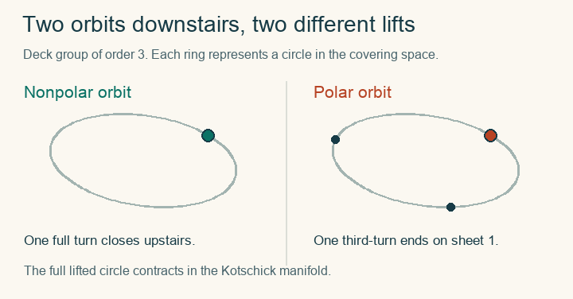

# A locally free symplectic circle action with contractible and noncontractible orbits

 ·  · 

Can a non-Hamiltonian symplectic circle action on a closed connected manifold have finite stabilizers and both contractible and noncontractible geometric orbits? **Yes.** For any integer $m ≥ 2$, a dimension-eight example has contractible principal orbits and exceptional orbits of exact order $m$ in the fundamental group. Products give the same result in every even dimension above eight. The dimension-six refinement remains open in this work.

[Read the paper (PDF)](paper/manuscript.pdf) · [LaTeX source](paper/manuscript.tex) · [Complete proof](proof/PROBLEM_AND_PROOF.md) · [Henigman–Karshon, Question 8.2](https://arxiv.org/pdf/2607.21159v1#page=27)

## Explore the proof in 3D

[Download the offline explorer](https://raw.githubusercontent.com/DannyExperiments/mixed-orbits-symplectic-circle-action/v1.0.0/visualization/construction-explorer.zip). Extract it, open `index.html` and switch between the pole and a point off the axis. The slider counts circuits in the geometric orbit downstairs.

## Why one orbit closes and the other does not

Take Kotschick's symplectic six-manifold with a free circle action whose orbits bound disks. Add a sphere. The cyclic group of order $m$ applies a simultaneous rotation by $1/m$ of a turn in the two factors. It acts freely on the product because it acts freely on the first factor, so the quotient is a smooth symplectic manifold.

Over a nonpolar point, one circuit of the quotient orbit lifts to the whole upstairs circle and bounds a disk. At a pole, the lift ends one sheet away; it takes exactly $m$ circuits to lift to the full upstairs orbit. At $m=3$ the successive polar endpoints are sheets 1, 2 and 0. Every full parametrization by the acting circle is null-homotopic in this example.

Pelayo's earlier finite diagonal quotient of a torus and a sphere already exhibits the two stabilizer types. Kotschick's input changes the topology of the lifted orbit, giving mixed contractibility and the prescribed finite order. [Prior art](audits/public_safe_reports/LITERATURE_AUDIT.md) · [Proof and dependencies](CLAIMS_EVIDENCE_MATRIX.md)

[Exact finite checks](REPRODUCIBILITY.md) · [Scope](CLAIM_SCOPE_AND_LIMITATIONS.md) · [AI disclosure](AI_DISCLOSURE.md) · [Citation](CITATION.cff)
